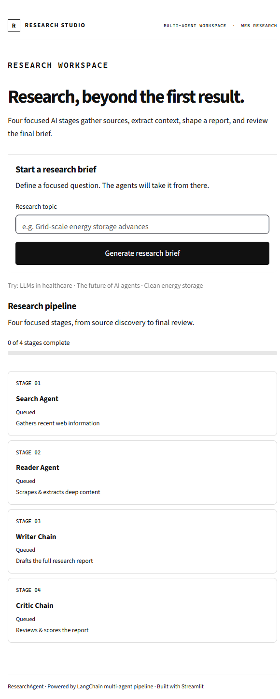
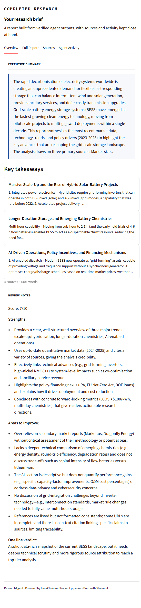

# Multi-Agent Research Assistant

A local Streamlit app that turns a research question into a sourced brief. Four focused stages search the web, extract useful page content, write a report, and review it.

## Screenshots

### Research workspace

The workspace shows the topic form, live progress, and the four-stage pipeline.



### Completed research

Example output for “Recent advances in grid-scale battery storage.” The report is AI-generated: check its claims against the linked sources before relying on them.



## Features

- **Four-stage research pipeline:** Search Agent, Reader Agent, Writer Chain, and Critic Chain, with stage status, timing, and overall progress.
- **Source-backed research:** finds relevant web pages, extracts readable content, and keeps source links with the result.
- **Structured report:** presents an executive summary, key takeaways, the full report, and critic review notes.
- **Report tabs:** switch between **Overview**, **Full Report**, **Sources**, and **Agent Activity**.
- **Export and share:** download the report as Markdown or PDF, or copy the report text.
- **Responsive, readable interface:** a light workspace with a pipeline layout that adapts to narrower screens.

## How the agents work

1. **Search Agent** uses Tavily to find relevant web pages for the topic.
2. **Reader Agent** extracts useful text from the selected pages.
3. **Writer Chain** synthesizes the gathered material into a structured research report.
4. **Critic Chain** reviews the report and provides a score, strengths, areas to improve, and a short verdict.

The pipeline updates its stage status and progress as work completes. The final report and its review appear together in the completed-research section.

## Requirements

- Python 3.10 or newer.
- A [OpenRouter API key](https://console.groq.com/keys) for report generation and review.
- A [Tavily API key](https://app.tavily.com/) for web search.
- Internet access while the agents search and retrieve source pages.

The app uses the Python packages listed in [`requirements.txt`](requirements.txt). Create your own API keys and keep them private; usage may be subject to the providers’ limits or billing.

## Setup and run

Run these steps from the `Multi Agent Research Bot` directory.

### 1. Get the project and open its directory

If you already have this repository, open a terminal in this app directory. Otherwise, clone the repository and change into the app folder:

```bash
git clone https://github.com/salmansrizon/interview-Prep-Case-Study.git
cd "interview-Prep-Case-Study/Complete Agentic AI/Multi Agent Research Bot"
```

### 2. Create and activate a virtual environment

**Windows PowerShell**

```powershell
py -m venv .venv
.\.venv\Scripts\Activate.ps1
```

If PowerShell blocks activation, use the Python executable in the environment directly (`.\.venv\Scripts\python.exe`) for the install and test commands below.

**macOS or Linux**

```bash
python3 -m venv .venv
source .venv/bin/activate
```

### 3. Install dependencies

With the virtual environment active:

```bash
python -m pip install --upgrade pip
python -m pip install -r requirements.txt
```

### 4. Add your API keys

Create a file named `.env` in this app directory and add your own keys:

```dotenv
OpenRouter_API_KEY=your_openrouter_api_key
TAVILY_API_KEY=your_tavily_api_key
```

Replace the example values with real keys. Do not paste keys into source files, screenshots, or commits.

### 5. Start the app

```bash
streamlit run app.py
```

Streamlit opens the app in your browser, usually at <http://localhost:8501>. If it does not open automatically, visit that address. To use another port:

```bash
streamlit run app.py --server.port 8502
```

## Use the app

1. Enter a focused research question in **Research topic**. A specific question or topic helps the agents find more relevant sources.
2. Select **Generate research brief**.
3. Follow the progress bar and the four pipeline stages while the agents work.
4. In the completed-research section, review the **Overview** and key takeaways.
5. Open **Full Report**, **Sources**, or **Agent Activity** to inspect the complete report, its references, or the pipeline output.
6. Use the Markdown/PDF download controls to save a copy, or **Copy report** to copy the report text.
7. Check the Critic Chain’s review notes and verify important claims against the cited sources.

Research results are held in the current Streamlit session; the app does not create a permanent public share link.

## Run the tests

From the app directory, with its virtual environment active:

```bash
python -m unittest discover -s tests -p "test_*.py"
```

The tests cover Tavily result normalization and PDF filtering, report overview and source extraction, and PDF generation.

## Project layout

```text
.
├── app.py                  # Streamlit interface and interactive pipeline
├── requirements.txt         # Python dependencies
├── src/
│   ├── agents/              # Search, reader, writer, and critic logic
│   ├── pipeline/            # Standalone pipeline orchestration
│   ├── tools/               # Tavily search and page extraction
│   └── reporting.py         # Report summaries, sources, and PDF export
├── tests/                   # Focused regression tests
└── screenshots/             # README screenshots
```

## Troubleshooting

- **Missing API key:** check that `.env` is in the app directory, the variable names are exactly `OpenRouter_API_KEY` and `TAVILY_API_KEY`, and the values are valid.
- **Package import error:** activate the project virtual environment and run `python -m pip install -r requirements.txt` again.
- **Port already in use:** start Streamlit with another port, for example `streamlit run app.py --server.port 8502`.
- **Search returns no usable pages:** confirm the Tavily key and internet connection, then try a more specific topic.
- **Report generation or review fails:** confirm the Groq key and provider availability; retry after correcting any key or connectivity issue.
- **PowerShell does not allow environment activation:** run `.\.venv\Scripts\python.exe -m pip install -r requirements.txt` and `.\.venv\Scripts\streamlit.exe run app.py` from the app directory.

## Documentation

- [Streamlit: run your app locally](https://docs.streamlit.io/develop/concepts/architecture/run-your-app)
- [LangChain: agents](https://docs.langchain.com/oss/python/langchain/agents)
- [Groq: OpenAI-compatible API](https://console.groq.com/docs/openai)
- [Tavily Python SDK](https://github.com/tavily-ai/tavily-python)
- [ReportLab: Platypus user guide](https://docs.reportlab.com/reportlab/userguide/ch5_platypus)
